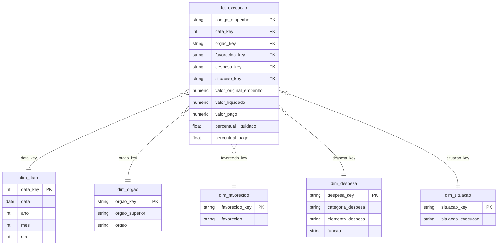
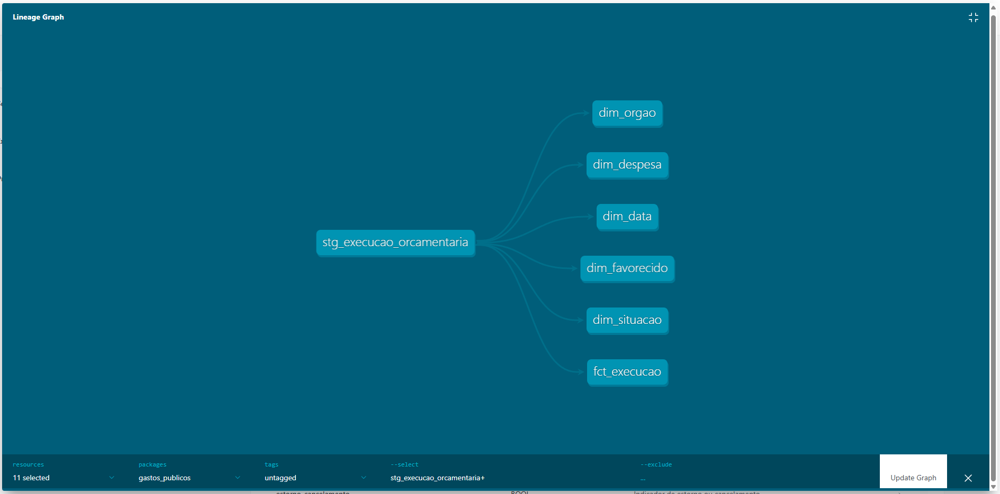
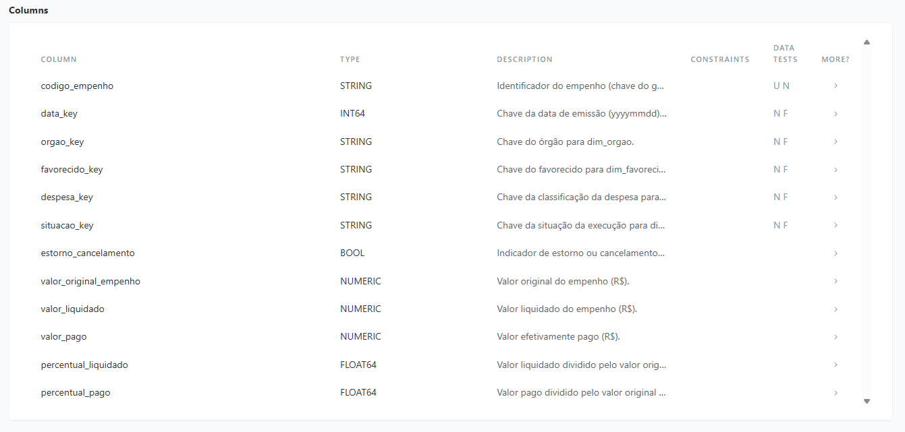

# Modelagem dimensional com dbt e BigQuery — Execução orçamentária federal

Projeto dbt que transforma a tabela plana de execução orçamentária (Portal da Transparência, agosto/2026) em um **modelo estrela documentado e testado** no BigQuery. É a evolução do projeto [análise de execução orçamentária](https://github.com/Ochion/analise-execucao-orcamentaria-portal-transparencia).

## Contexto
A base tratada em Python tinha 205.378 empenhos em uma única tabela de 15 colunas. Funciona para um dashboard, mas mistura descrição e medidas, repete textos em cada linha e não tem regras de qualidade versionadas.

## Ação
1. **Staging:** limpeza e tipagem da tabela de origem (textos vazios viram "Não informado", valores ausentes viram 0) e criação das chaves das dimensões com hash MD5.
2. **Marts:** modelo estrela com uma fato e cinco dimensões.
3. **Testes:** unicidade e não nulidade das chaves, integridade referencial entre fato e dimensões, valores aceitos na situação da execução e dois testes singulares de reconciliação (contagem de linhas e total pago entre staging e fato).
4. **Documentação:** descrição de todos os modelos e colunas em YAML e site de documentação com o grafo de linhagem (`dbt docs`).

## Modelo



**Grão da fato:** um registro por empenho.

| Tabela | Linhas |
|---|---|
| `fct_execucao` | 205.378 |
| `dim_favorecido` | ~56,9 mil |
| `dim_despesa` | 739 |
| `dim_orgao` | 209 |
| `dim_data` | 31 |
| `dim_situacao` | 5 |

## Resultado
- `dbt build` concluído com **34 de 34 etapas aprovadas**: 7 modelos (1 staging, 1 fato e 5 dimensões) e 27 testes de dados.
- A fato tem o mesmo número de linhas e o mesmo total pago da staging, validados por dois testes de reconciliação.
- Na primeira execução, o teste de valores aceitos acusou uma divergência nos textos da situação da execução (vírgulas e maiúsculas que eu não esperava). Corrigi o teste e o pipeline passou por completo.

### Linhagem dos modelos


### Colunas da tabela fato


## Como executar
```bash
python3 -m venv .venv
source .venv/bin/activate
pip install -r requirements.txt
gcloud auth application-default login
# copie profiles.yml.example para ~/.dbt/profiles.yml e ajuste
dbt debug
dbt build
dbt docs generate
dbt docs serve
```
Rodei o projeto no Google Cloud Shell. No Windows, uma política de controle de aplicativos pode bloquear bibliotecas do adaptador do BigQuery.

## Stack
dbt Core, BigQuery, SQL, Git.
