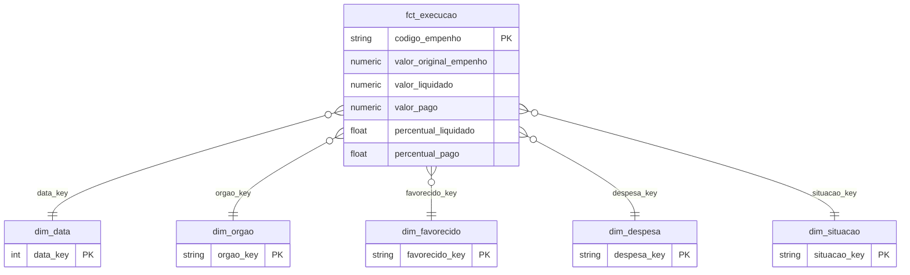

# Modelagem dimensional com dbt e BigQuery — Execução orçamentária federal

Projeto dbt que transforma a tabela plana de execução orçamentária (Portal da Transparência, agosto/2026) em um **modelo estrela documentado e testado** no BigQuery. É a evolução do projeto [análise de execução orçamentária](https://github.com/Ochion/analise-execucao-orcamentaria-portal-transparencia).

## Contexto
A base tratada em Python tinha 205.378 empenhos em uma única tabela de 15 colunas. Funciona para um dashboard, mas mistura descrição e medidas, repete textos em cada linha e não tem regras de qualidade versionadas.

## Ação
1. **Staging:** limpeza e tipagem da tabela de origem (textos vazios viram "Não informado", valores ausentes viram 0) e criação das chaves das dimensões com hash MD5.
2. **Marts:** modelo estrela com uma fato e cinco dimensões.
3. **Testes:** unicidade e não nulidade das chaves, integridade referencial entre fato e dimensões, valores aceitos na situação da execução e dois testes singulares de reconciliação (contagem de linhas e total pago entre staging e fato).
4. **Documentação:** descrição de todos os modelos e colunas em YAML e site de documentação com o grafo de linhagem (`dbt docs`).

## Modelo



**Grão da fato:** um registro por empenho.

## Resultado
<!-- Preencha com os números reais depois de rodar `dbt build`. -->
- Modelos criados: 1 staging, 1 fato e 5 dimensões.
- Testes executados: `__` aprovados, `__` com aviso, `__` falhas.
- Linhas na fato: `__` (igual à staging).

## Como executar
```bash
python -m venv .venv
.venv\Scripts\activate
pip install -r requirements.txt
gcloud auth application-default login
# copie profiles.yml.example para ~/.dbt/profiles.yml e ajuste
dbt debug
dbt build
dbt docs generate
dbt docs serve
```

## Stack
dbt Core, BigQuery, SQL, Git.
